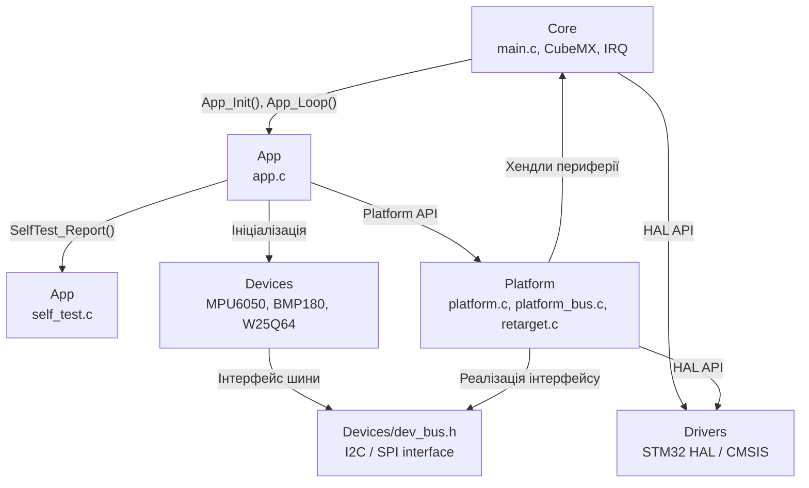

# Архітектура прошивки SmartLock

## 1. Загальна структура

Прошивка SmartLock побудована за багатошаровою архітектурою,
яка відокремлює прикладну логіку від апаратно-залежного коду.

| Шар | Каталог | Призначення |
|---|---|---|
| Application | firmware/App/ | Логіка SmartLock, ініціалізація пристроїв і UART self-test |
| Devices | firmware/Devices/ | Драйвери BMP180, MPU6050, W25Q64 |
| Platform | firmware/Platform/ | Адаптація шин I2C/SPI/UART до STM32 HAL |
| Core | firmware/Core/ | Ініціалізація периферії, системні налаштування та main.c |
| Drivers | firmware/Drivers/ | Бібліотеки STM32 HAL і CMSIS |

## 2. Правила залежностей

- App використовує Platform та Devices.
- Devices використовує абстрактний інтерфейс dev_bus.h.
- Platform взаємодіє з Core, HAL та Devices.
- Core містить код, згенерований STM32CubeMX.
- Devices не залежить від HAL або конкретного мікроконтролера.

Правила залежностей автоматично перевіряються командою:

    make check-deps

## 3. UART Self-Test

Модуль firmware/App/self_test.c формує структурований звіт
про результати перевірки пристроїв.
Перевірки пристроїв стенда — firmware/App/stand_test.c, UART-команди стенда — firmware/App/bench.c.

Підтримувані статуси: OK, WARN, FAIL, SKIP.

Приклад повідомлень:

    ST,START
    ST,MPU6050,FAIL,err=nack
    ST,BMP180,OK
    ST,W25Q64,OK
    ST,SUMMARY,FAIL,ok=2,warn=0,fail=1,skip=0

Форматування перевіряється хостовими тестами без фізичної плати:

    make test

	
## 4. Component Diagram

Діаграма відображає основні компоненти прошивки SmartLock та їхні залежності.

