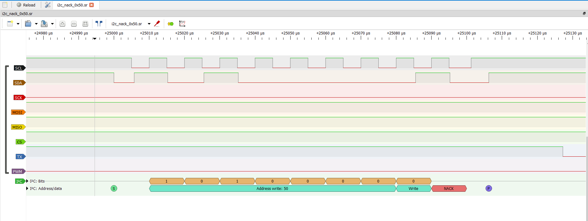
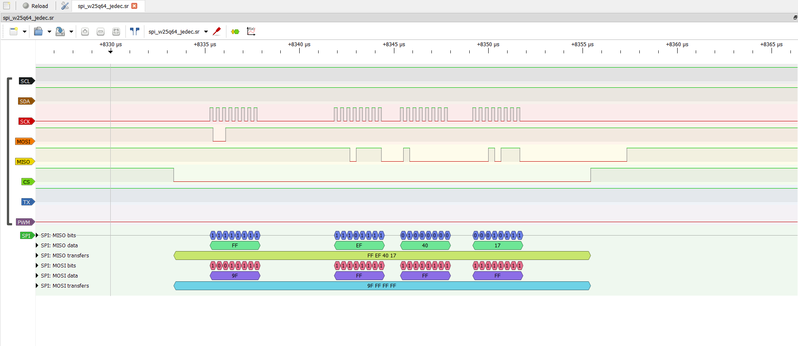
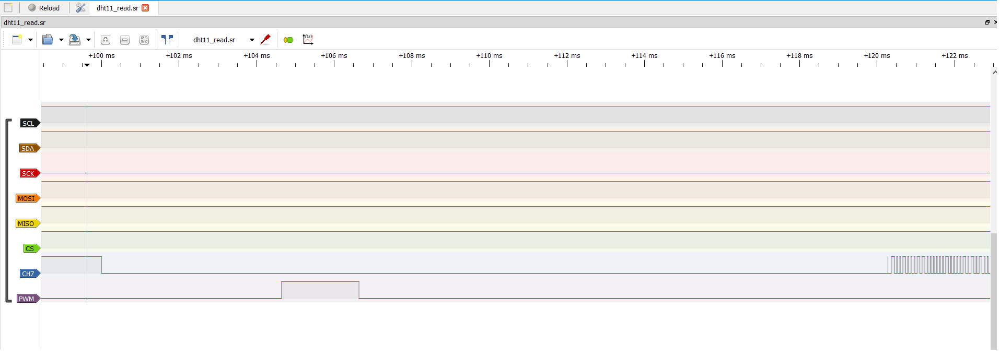

# Аналіз сигналів логічного аналізатора (ЛР2)

**Проєкт:** SmartLock на базі STM32 (NUCLEO-F411RE)  
**Автор аналізу:** Роман Собкович  
**Обладнання:** Логічний аналізатор 24 MHz 8CH (fx2lafw / PulseView 0.4.2)  
**Гілка:** `feature/analyzer-analysis`

---

## 1. Загальний огляд знятих трафіків

Нижче наведено паспортизацію 13 вимірювальних файлів (.sr), знятих під час тестування стенда SmartLock:

| # | Файл (.sr) | Інтерфейс / Сигнал | Частота дискр. | Опис та декодовані дані | Статус |
|---|---|---|---|---|---|
| 1 | `i2c_scan.sr` | I²C | 4 MHz | Сканування шини (0x09…0x77). Знайдено адреси 0x1D, 0x21, 0x6B, 0x77 (SCL 100 кГц) | OK |
| 2 | `i2c_bmp180_read.sr` | I²C | 4 MHz | Читання T/P з датчика BMP180. Перевірка repeated START та паузи конверсії (~5.7 мс) | OK |
| 3 | `i2c_nack_0x50.sr` | I²C (Аномалія) | 4 MHz | Спроба звернення до неіснуючої адреси 0x50. Фіксація відповіді NACK | OK (Аномалія) |
| 4 | `sccb_ov7670_pid.sr` | SCCB (I²C) | 4 MHz | Читання PID (0x76) та VER (0x73) камери OV7670 | OK |
| 5 | `spi_w25q64_jedec.sr` | SPI | 12 MHz | Читання JEDEC ID флеш-пам'яті W25Q64 (байти EF 40 17). SCK = 3.0 МГц | OK |
| 6 | `spi_w25q64_write.sr` | SPI | 12 MHz | Операція стирання сектора (55.5 мс) та запису 256 байт з командою WREN (0x06) | OK |
| 7 | `uart_selftest.sr` | UART | 1 MHz | Лог стартової самоперевірки системи (115200 8N1, біт ≈ 8.7 мкс) | OK |
| 8 | `pwm_servo_1000.sr` | PWM | 1 MHz | Імпульс керування сервоприводом 1000 мкс (кут 0°), період 20 мс (50 Гц) | OK |
| 9 | `pwm_servo_2000.sr` | PWM | 1 MHz | Імпульс керування сервоприводом 2000 мкс (кут 180°), період 20 мс (50 Гц) | OK |
| 10 | `gpio_button_bounce.sr` | GPIO (Кнопка) | 1 MHz | Аналіз натискання механічної кнопки на наявність дребезгу | Без аномалії |
| 11 | `dht11_read.sr` | 1-Wire | 1 MHz | Зчитування датчика DHT11 (40 біт: 35.2%, 21.4°C). Ідеально для ручного аналізу | OK |
| 12 | `cam_vsync_glitch.sr` | GPIO (VSYNC) | 1 MHz | Сигнал вертикальної синхронізації камери (30 Гц, період 33.32 мс) | Без аномалії |
| 13 | `cam_vsync_href_pclk.sr` | DVP (Паралельна) | 12 MHz | Строби кадру камери (PCLK 375 кГц, 1280 тактів на рядок) | OK |

---

## 2. Аналіз транзакцій за шинами та порівняння з Datasheet

  
   
  <em>Рисунок 1 — Трейс аномалії NACK на шині I²C при зверненні до неіснуючої адреси 0x50</em>

### 2.1. Шина I²C (Датчик MPU-6050 / BMP180)
* **Налаштування:** Standard Mode (100 кГц).
* **Виміряна частота SCL:** 100.00 кГц (t_HIGH = 5.0 мкс, t_LOW = 5.0 мкс).
* **Очікувана частота:** 100 кГц (CubeMX I2C1). Відхилення: **0%**.
* **Опис транзакцій:** Сканування шини показало відгуки ACK на адресах `0x1D`, `0x21`, `0x6B`, `0x77`. При зчитуванні BMP180 зафіксовано repeated START перед читанням та паузу конверсії ~5.7 мс (за даташітом максимум 4.5 мс для T — витримано з запасом).

  
   
  <em>Рисунок 2 — Зчитування JEDEC ID (команда 0x9F, відповідь EF 40 17) по шині SPI</em>

### 2.2. Шина SPI (Флеш-пам'ять W25Q64JV)
* **Налаштування:** SPI Mode 0 (CPOL=0, CPHA=0), дільник Prescaler = 16 (48 МГц / 16 = 3 МГц).
* **Виміряна частота SCK:** 3.000 МГц. Відхилення від розрахункової: **0%**.
* **Операція стирання:** Тривалість стирання сектора `t_SE` склала **55.5 мс** (типове значення за даташітом — 45 мс, максимальне — 400 мс, виміряне значення у межах норми).
* **Вектор команд:** Обов'язкова команда дозволу запису `WREN` (`0x06`) передує операціям стирання та запису сторінки (256 байт).

### 2.3. Камера OV7670 (SCCB та DVP)
* **Шина SCCB:** Читання PID (`0x76`) та VER (`0x73`) з адреси `0x21`. Фіксується відмінність SCCB від стандартного I²C — наявність STOP-біта між записом адреси регістру та читанням замість repeated START.
* **Тактування DVP:** Виміряна частота PCLK склала **375 кГц** (при XCLK = 24 МГц та дільнику CLKRC = 0x1F: 24 МГц / 64 = 375 кГц). Відхилення: **0%**. Тривалість кадру VSYNC = 33.32 мс (30 Гц).

  
   
  <em>Рисунок 3 — Вимірювання керуючого імпульсу сервоприводу тривалістю 1000 мкс (50 Гц)</em>

### 2.4. Сервопривід SG92R (PWM)
* **Налаштування таймера:** TIM3 (PSC = 95, ARR = 19999), частота 50 Гц (період 20 000 мкс).
* **Кут 0° (`pwm_servo_1000.sr`):** Тривалість імпульсу **1000.0 мкс**, період 20000 мкс (50.000 Гц).
* **Кут 180° (`pwm_servo_2000.sr`):** Тривалість імпульсу **2000.0 мкс**, період 20000 мкс (50.000 Гц).
* **Відхилення:** 0% за частотою та тривалістю імпульсів.

### 2.5. Консоль UART
* **Налаштування:** 115200 8N1.
* **Виміряна тривалість біта:** ~8.7 мкс ($1 / 115200 \approx 8.68$ мкс). Швидкість повністю відповідає конфігурації.

---

  
   
  <em>Рисунок 4 — Осцилограма стартового імпульсу та бітів даних 1-Wire сенсора DHT11</em>

## 3. Ручне декодування сигналу (1-Wire DHT11)

Для проведення ручного аналізу обрано трейс `dht11_read.sr` (частота дискретизації 1 MHz):

* **Стартовий імпульс МК:** утримання лінії LOW протягом **20.28 мс** (вимога даташіту ≥ 18 мс), після чого МК відпускає лінію.
* **Відповідь датчика (PULL/RESPONSE):** DHT11 притискає лінію до LOW на **81 мкс**, потім HIGH на **85 мкс**.
* **Структура бітів (40 біт загалом):**
  * Кожен біт починається зі спаду LOW тривалістю **56 мкс**.
  * **Логічний 0:** пауза HIGH тривалістю **24 мкс** (за даташітом 26–28 мкс).
  * **Логічна 1:** пауза HIGH тривалістю **72 мкс** (за даташітом ~70 мкс).
* **Декодована послідовність байтів:** `0x23 0x02 0x15 0x04 0x3E`
  * Вологість: `0x23` = 35% (ціла), `0x02` = 0.2% $\rightarrow$ **35.2%**
  * Температура: `0x15` = 21°C (ціла), `0x04` = 0.4°C $\rightarrow$ **21.4°C**
  * Контрольна сума: $0x23 + 0x02 + 0x15 + 0x04 = 0x3E$ (контрольна сума збіглася повністю).

---

## 4. Дослідження аномалії на шині I²C

У трейсі `i2c_nack_0x50.sr` зафіксовано штучно згенеровану аномальну транзакцію:

* **Опис події:** Майстер (STM32) ініціював транзакцію запису на адресу `0x50` (`S W@50`).
* **Отриманий сигнал:** Після відправки 7 бітів адреси та біта R/W=0 ведений пристрій не притиснув лінію SDA до землі на 9-му такті SCL.
* **Результат:** На шині зафіксовано біт **NACK** (High level), після чого МК сформував біт **STOP (P)**.
* **Причина аномалії:** Модуль із адресою `0x50` відсутній на фізичній шині SmartLock.
* **Інженерний висновок:** Прошивка МК коректно обробляє апаратну помилку NACK, не викликаючи зациклення контролера.

---

## 5. Підсумок та експорт тестових векторів

Декодовані послідовності байтів для шин SPI, I²C та 1-Wire скопійовані та передані відповідальному за модульне тестування для створення тестових фікстур (unit tests).