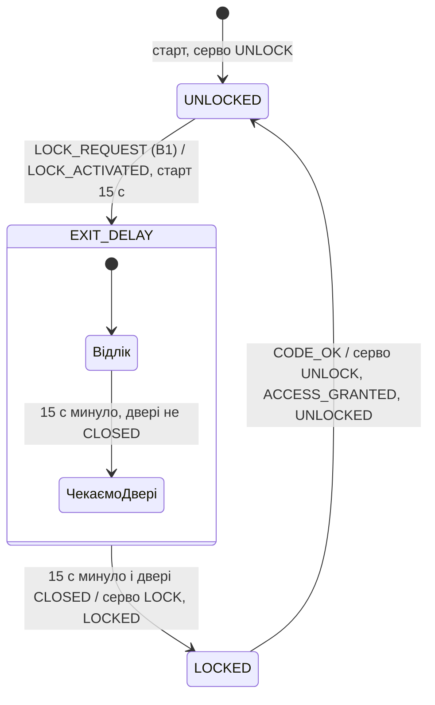

# FSM і контроль доступу SmartLock (ЛР3, Коваль, K02–K09)

Код: `firmware/App/sl_fsm.{h,c}`, `sl_buttons`, `sl_security`, `sl_env`, `sl_journal`, `sl_camera_link`. Модулі зв'язані лише чергою подій (`event_queue.h`); FSM — єдина, хто керує серво. Інтеграція журналу і камери для H09/I09 — `journal-camera-integration.md`.

## 1. Стани (FR-01, FR-13)

Двері до першої `DOOR_*` невідомі = відчинені (не блокувати наосліп). Автоблокування немає (FR-11).

## 2. Подія × стан → дія

| Подія (хто кладе) | UNLOCKED | EXIT_DELAY | LOCKED |
|---|---|---|---|
| `LOCK_REQUEST` (buttons, arg = мс прийняття B1) | → EXIT_DELAY, `LOCK_ACTIVATED` | ігнор (відлік не перезапускається) | ігнор |
| `DOOR_CLOSED` (security) | `DOOR_CLOSED` | `DOOR_CLOSED`; якщо відлік завершено — LOCK | `DOOR_CLOSED` |
| `DOOR_OPEN` (security) | `DOOR_OPEN` | `DOOR_OPEN`, LOCK не буде до закриття | `FORCED_OPEN`, стан LOCKED, без фото |
| `CODE_OK` (buttons, arg = довжина) | ігнор | ігнор | серво UNLOCK, `ACCESS_GRANTED`, `UNLOCKED` |
| `CODE_WRONG` (buttons) | ігнор | ігнор | `WRONG_CODE`, стан LOCKED |
| `MOTION` (security, arg = 0) | ігнор | ігнор | `MOTION` + 1 кадр → `PHOTO`/`PHOTO_ERR` (ref = ID) |
| `TAMPER` (security, arg = мг понад поріг) | ігнор | ігнор | `TAMPER` + 1 кадр → `PHOTO`/`PHOTO_ERR` |
| `ENV_WARNING` (env, arg = маска T/RH) | `ENV_WARNING` | `ENV_WARNING` | `ENV_WARNING` (стан не змінює) |
| кінець 15 с (час FSM) | — | двері CLOSED → серво LOCK, `LOCKED` (arg = фактична затримка) | — |

`DOOR_*` у журнал — лише якщо `TBD_SL_LOG_DOOR_EVENTS` = 1. Повтор того самого стану дверей ігнорується.

## 3. Які хуки чим заміщено

| Хук (`smartlock_hooks.h`) | Сильна реалізація | Ініціалізація на платі |
|---|---|---|
| `SmartLock_FsmStep` | `sl_fsm.c` (+ `SmartLock_CameraLinkPoll`) | ледача: перший виклик → `SmartLock_FsmInit()` |
| `SmartLock_ButtonsPoll` | `sl_buttons.c` | ледача: перший виклик запам'ятовує рівні |
| `SmartLock_SecurityPoll` | `sl_security.c` | нульовий стан; MPU — `app_devices` з `App_Init()` |
| `SmartLock_EnvPoll` | `sl_env.c` (рядок `ENV,...` як у слабкому) | нульовий стан |
| `SmartLock_StoragePoll` | `sl_journal.c` (рядок `EVT,...`) | нульовий стан; `last_seq` — при першому записі |

Лишаються слабкими (заміна без правок App/): `SmartLock_JournalOps()` (H09, зараз `flash=err`) і `SmartLock_CameraRequest()` (I09, зараз відмова → `PHOTO_ERR`, статус 1 REJECTED). `smartlock_hooks_weak.c` не видалено; його перевіряє окремий бінарник `test_hooks_weak` без `sl_*.o`.

## 4. Параметри TBD_ (не вимоги PRD; погодити до звіту)

| Ім'я | Файл | Значення | Джерело | Погоджує |
|---|---|---|---|---|
| `TBD_PERIOD_BUTTONS_US` / `_SECURITY_US` / `_ENV_US` | app_config.h | 10 мс / 20 мс / 2 с | I02; DHT11 ≥ 1 с (datasheet) | Коваль + Сюкало (L01/L02) |
| `TBD_EVQ_LEN` | app_config.h | 8 | I02; максимум 6 подій за прохід (2 buttons + 3 security + 1 env) | Непорожній (I02) |
| `TBD_BTN_DEBOUNCE_MS` | sl_buttons.h | 20 мс | стенд ЛР2 (команда g); дребезг не виміряно | Сюкало (L01) |
| `TBD_CODE_LEN` / `TBD_CODE_VALUE` | sl_buttons.h | 4 / {1,3,2,4} | тимчасово | Сюкало (L01) |
| `TBD_CODE_TIMEOUT_MS` | sl_buttons.h | 5000 мс | тимчасово | Сюкало (L01) |
| `TBD_DOOR_DEBOUNCE_MS` | sl_security.h | 100 мс | логи 03, 04 (найкоротший стан 624 мс) | Коваль + Колодницький |
| `TBD_PIR_MIN_INTERVAL_MS` | sl_security.h | 8000 мс | логи 03, 04 (серії HC-SR501 3,1–6,5 с) | Коваль + Сюкало |
| `TBD_TAMPER_THRESHOLD_MG` | sl_security.h | 200 мг (L1-норма Δ між зразками) | логи 08, 09, 11 (шум ≤ 32 мг); ударів у логах немає | Коваль + Колодницький, Сюкало |
| `TBD_TAMPER_MIN_INTERVAL_MS` | sl_security.h | 1000 мс | оцінка | Коваль + Колодницький |
| `TBD_MPU_BASELINE_SAMPLES` / `_ZERO_LIMIT` / `_ERR_LIMIT` | sl_security.h | 5 / 3 / 3 | логи 08, 09, 10, 15 | Коваль + Непорожній |
| `TBD_MPU_RETRY_MS` | sl_security.h | 1000 мс | лог 15 (зависла шина ≈ 26 мс) | Коваль + Непорожній |
| `TBD_ENV_T_MIN_C` / `_T_MAX_C` | sl_env.h | 5 / 40 °C | паспорт DHT11 0–50 °C | Сюкало (L01) |
| `TBD_ENV_RH_MIN_PCT` / `_RH_MAX_PCT` | sl_env.h | 20 / 80 % | паспорт DHT11 20–90 % | Сюкало (L01) |
| `TBD_ENV_WARN_DURATION_MS` | sl_env.h | 60 000 мс | тимчасово (30 зразків) | Сюкало (L01) |
| `TBD_ENV_T_HYST_C` / `_RH_HYST_PCT` | sl_env.h | 1 °C / 3 % | точність DHT11 ±2 °C / ±5 % | Сюкало (L01) |
| `TBD_ENV_DHT_ERR_RESET_COUNT` | sl_env.h | 5 | тимчасово | Коваль |
| `TBD_SERVO_LOCK_US` / `_UNLOCK_US` | sl_fsm.h | 2000 / 1000 мкс | pinout §4, лог 06; напрям — механіка макета | Колодницький (стенд) |
| `TBD_SL_LOG_DOOR_EVENTS` | sl_fsm.h | 1 | PRD явно вимагає лише `FORCED_OPEN` | Сюкало (L01) |
| `TBD_JOURNAL_FIFO_LEN` / `_FIFO_RESERVE` | sl_journal.h | 16 / 2 | оцінка; уточнити за `JournalMaxDepth()` у S1–S3 | Коваль + Колодницький (H09) |
| `TBD_JOURNAL_RETRY_MAX` / `_RETRY_MS` | sl_journal.h | 5 / 100 мс | tSE до 400 мс (datasheet), 64 мс (лог 14) | Колодницький (H09) |
| `TBD_CAMLINK_PENDING_MAX` | sl_camera_link.h | 4 | оцінка | Непорожній (I09) |
| `TBD_CAM_RESULT_TIMEOUT_MS` | sl_camera_link.h | 10 000 мс | tasks.md §5 (до 1,07 с + до 4,6 с) | Непорожній (I09) + H14 |

Затверджене PRD число одне: `SL_EXIT_DELAY_MS` = 15 000 мс ± 100 мс (FR-03, D.2). Формат запису Flash `SL_LOG_REC_BYTES` = 32 Б — лише пропозиція для H09 (FR-08 «потребує узгодження»).

## 5. Host-тести (без плати)

Усе: `make -C tests clean && make -C tests run && make -C tests coverage && sh scripts/check_deps.sh`. Окремий бінарник: `make -C tests run-<ім'я>`.

| Картка | Тест | Що перевіряє |
|---|---|---|
| K02 | `run-sl_fsm` | переходи, 15 с на межі 14 999/15 000 і через переповнення, двері, FORCED_OPEN, CODE_*, ігнор поза LOCKED |
| K03, K04 | `run-sl_buttons` | антидребезг 5 кнопок, одна подія на натискання, код, акорд, тайм-аут, мітка B1 |
| K05 | `run-sl_security` | геркон з антидребезгом, PIR-серії, TAMPER, відмови MPU (I²C, нулі, повтор) |
| K06 | `run-sl_env` | межі, гістерезис, тривалість, відмови DHT11/BMP180, рядок ENV |
| K07 | `run-sl_journal` | FIFO, резерв, seq, повтори append, рядок EVT, пакування запису |
| K08 | `run-sl_fsm` (частина K08), `run-sl_journal` | рівно один PHOTO/PHOTO_ERR на MOTION/TAMPER, тайм-аут, відмова камери |
| K09 | `run-sl_integration` | наскрізні E2E-01…04 через `Sched_RunOnce`: B1 з дребезгом → 15 с, відчинені двері, коди, PIR+MPU, FORCED_OPEN, відмови датчиків, ENV_WARNING, 100 подій |
| I02 | `run-sched`, `run-hooks_weak` | каркас циклу, прямі виклики сильних хуків; слабкі хуки без `sl_*` |

## 6. Стендові перевірки (Колодницький, H13)

UART 115200 8N1; перший рядок `BUILD,...,git=<hash>` — записати хеш. Поки немає H09, у кожному `EVT` буде `flash=err`.

- [ ] **Напрям серво.** Після старту — `TBD_SERVO_UNLOCK_US` (1000 мкс). Пройти LOCK → засувка фізично закрита? Якщо навпаки — поміняти `TBD_SERVO_LOCK_US`/`_UNLOCK_US` місцями. UART: `EVT,...,name=LOCKED,arg=15000`.
- [ ] **15 с.** Двері зачинені, B1. Аналізатор: PC13 (спад) і PA6 (зміна ширини імпульсу); 10 прогонів, записати max відхилення. Очікування: від фізичного натискання 15,020–15,08 с (див. §7); `LOCK_ACTIVATED`.`t_ms` → `LOCKED`.`t_ms` ≈ 15 000 + один прохід. Окремо — секундомір як санітарна перевірка.
- [ ] **Реальний дребезг.** 20 швидких натискань B1 і кожної з 4 кнопок, записати сирий сигнал (1 МГц). Найдовший відскок має бути < `TBD_BTN_DEBOUNCE_MS` (20 мс); в UART — рівно один `LOCK_ACTIVATED` і жодного зайвого символу коду (5 правильних кодів → 5 `ACCESS_GRANTED`, 5 неправильних → 5 `WRONG_CODE`).
- [ ] **Геркон.** Дребезг/вібрація дверей при закритті < 100 мс; двері відчинені після 15 с → `LOCKED` лише після закриття, без другого відліку; відкриття в LOCKED → `FORCED_OPEN`, стан не UNLOCKED.
- [ ] **Поріг TAMPER.** У LOCKED: 10 контрольованих ударів (записати силу/висоту падіння тіла) → по одному `TAMPER` (arg = мг понад поріг) і по одному `PHOTO_ERR`/`PHOTO`; 10 легких дотиків → нічого. Перевірити, чи не дає `TAMPER` сама засувка (рух SG92R одразу після `LOCKED`) і зачинення дверей.
- [ ] **PIR-серії.** Одна присутність 30 с у LOCKED → `MOTION` не частіше 1 раз на 8 с; рух у UNLOCKED → жодного `MOTION`. Перевірити режим перемички HC-SR501 (повторний тригер тримає вихід HIGH — нового фронту не буде).
- [ ] **DHT11 перевищення.** Нагріти датчик > 40 °C (фен) на > 60 с → один `EVT,...,name=ENV_WARNING,arg=1`; коротке нагрівання (< 60 с) → нічого. Рядки `ENV,dht=ok,t_c=...` кожні 2 с.
- [ ] **Відмови датчиків.** По черзі від'єднати DHT11, GY-89 (BMP180), MPU-6050 у UNLOCKED і в LOCKED: `ENV,dht=err` / `bmp=err`, жодних `LOCK`/`UNLOCK`, засувка не рухається; цикл не зависає (CPU Load, `STAT`).

## 7. Відомі обмеження

- **Похибка FR-03.** 15 с рахуються від мітки прийнятого B1 (`Platform_Millis()`, 1 мс). Від прийнятого натискання: −1 … +(найдовший прохід) мс; у нормі прохід з env ≈ 24 + 10 + 4 ≈ 41 мс (DHT11, BMP180, рядок ENV) → ≈ +45 мс; із зависанням I²C MPU (≈ 26 мс, раз на 1 с) — до ≈ +70 мс. Від фізичного дотику додається 20…30 мс (антидребезг + фаза опитування 10 мс) + до ≈ 45 мс затримки опитування buttons: найгірше ≈ +80 мс (env не може затримати обидва кінці: 15 с не кратні 2 с). Діагностичні команди ЛР2 (`h` ≈ 8 с) порушують вимогу — не використовувати під час вимірювання.
- Камера (I09) і Flash (H09) — заглушки: кожна MOTION/TAMPER у LOCKED дає `PHOTO_ERR` REJECTED, кожен запис — `flash=err`.
- Фронти EXTI (`b1_edge`, `pir_edge`) поки `false` (I04): удар коротший за 20 мс може бути пропущений.
- Лічильники діагностики (`SlSecurity_MpuHealthy`, `SmartLock_ButtonsDropped`, `JournalDropped` …) у UART не виводяться — потрібна команда STATS (I10).
- Інтервал PIR/TAMPER не знає стану FSM: імпульс у EXIT_DELAY гасить наступний на 8 с уже в LOCKED.
- Відкриті рішення (PRD мовчить): скасування EXIT_DELAY (зараз неможливе, двері відчинені — чекаємо вічно), обмеження спроб коду, CODE_OK під час EXIT_DELAY (ігнорується).
