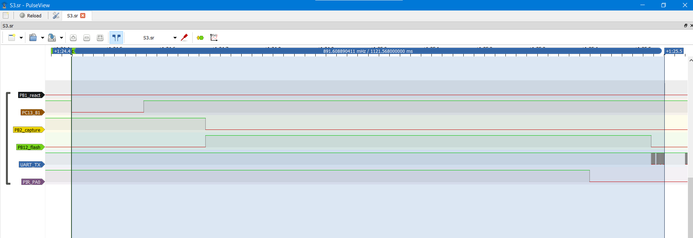

# DWT проти логічного аналізатора (ЛР3, M06)

Методичка §6.3 «Між способами вимірювання»: ті самі метрики отримано двома незалежними способами
і пояснено різницю. Порівнюються:

* **DWT** — мітки часу прошивки `EVT t_us=…` в UART-лозі (лічильник тактів ядра, 96 МГц);
* **логічний аналізатор** — фронти на фізичних пінах (fx2lafw, `sigrok-cli`), службові GPIO I05.

| Запис аналізатора | Лог DWT | Дискретизація | Тривалість запису |
|---|---|---|---|
| `docs/captures/S3.sr` | `docs/metrics/S3_uart_raw.txt` | 500 кГц (крок 2 мкс) | 160 с (обрив USB, `S3_conditions.md`) |
| `docs/captures/S3_try1.sr` | `docs/metrics/S3_try1_uart_raw.txt` | 1 МГц (крок 1 мкс) | 153 с |

Прошивка `5774b8a`, сценарій S3 (H12). Канали: D0 = PB1 (реакція), D1 = PC13 (кнопка B1),
D4 = PB2 (захоплення кадру), D5 = PB12 (запис кадру у W25Q64), D7 = PA0 (вихід PIR).

## 1. Як зіставлено час

* Аналізатор і МК мають різні годинники, тому час аналізатора прив'язано до першої зйомки кадру:
  фронт PB2 = `capture_start` у лозі. Перші два імпульси PB2 / PB12 по 14,5 мс з'являються одночасно
  на обох каналах під час старту прошивки (ініціалізація пінів). Це не зйомка, їх пропущено.
* **Годинники розходяться на 6,6 ppm:** різниця між аналізатором і DWT рівномірно росте на ≈ 0,66 мс
  за 100 с. Її враховано лінійною поправкою за 15 початками зйомок і записів; після поправки
  розбіжність ≤ 5 мкс.

## 2. Тривалість довгих операцій

Ширина імпульсу PB2 / PB12 на аналізаторі проти різниці `capture_done − capture_start` /
`flash_wr_done − flash_wr_start` за DWT.

| Операція | n | Тривалість (аналізатор) | DWT − аналізатор |
|---|---:|---:|---:|
| захоплення кадру OV7670 | 8 + 1 | 1 272 … 2 029 мс | +2 … +7 мкс (середнє 4,4) |
| запис кадру у W25Q64 | 7 + 1 | 827,5 … 846,0 мс | +10 … +12 мкс (середнє 11,3) |

«+ 1» — подія із `S3_try1.sr` (різниця 0 і +12 мкс). Розбіжність — тисячні частки відсотка.
Невелика стала добавка DWT пояснюється тим, що мітки `EVT` ставляться за кілька рядків коду до
`PROBE_ON` і після `PROBE_OFF`; ще ±2 мкс дає крок дискретизації.

## 3. Затримка реакції на подію

* **Аналізатор:** фізичний фронт (PC13 для B1, PA0 для PIR) → фронт PB1, коли задача забрала подію.
* **DWT:** `btn_b1_press → btn_b1_handled`, `pir_trig → pir_handled`. Мітка `*_press` / `*_trig`
  ставиться в обробнику переривання, тобто DWT не бачить часу від фронту до входу в ISR.

| | Подій | Збіг (різниця ≤ 4 мкс) | Від фронту до мітки ISR |
|---|---:|---:|---:|
| B1, `S3.sr` | 7 | 6 | 2,4 … 4,5 мкс |
| PIR, `S3.sr` | 19 | 18 | 1,5 … 3,8 мкс |
| B1 і PIR, `S3_try1.sr` | 3 + 3 | 6 | — |

Подій B1 у `S3.sr` (час від початку запису, для перевірки курсорами в PulseView):

| t у `S3.sr` | Аналізатор | DWT | Різниця | Примітка |
|---:|---:|---:|---:|---|
| 31,720 с | 8,166 мс | 8,167 мс | −1 мкс | |
| 52,877 с | 2,434 мс | 2,433 мс | +1 мкс | |
| 68,691 с | 15,134 мс | 15,134 мс | 0 | |
| **84,418 с** | **1 122,494 мс** | **1 122,220 мс** | **+274 мкс** | під час зйомки кадру |
| 114,533 с | 6,010 мс | 6,010 мс | 0 | |
| 133,946 с | 642,746 мс | 642,750 мс | −4 мкс | під час запису у Flash |
| 147,649 с | 9,854 мс | 9,854 мс | 0 | |

Події 84,418 с і 133,946 с — валідні події № 1 і № 2 з `S3_conditions.md`.

### Анотований запис

Сесія PulseView: [`docs/captures/S3.pvs`](../captures/S3.pvs) — відкривати разом із `S3.sr`. У ній
підписано канали й поставлено маркери на дві події з таблиці нижче.

| Маркер | B1 (PC13 ↓) | Що в цей момент виконується | PB1 ↑ (реакція) | Затримка |
|---|---:|---|---:|---:|
| B1 під час зйомки | 84,418 440 с | зйомка PB2 83,018–84,672 с, далі запис PB12 84,672–85,515 с | 85,540 934 с | **1 122,494 мс** |
| B1 під час запису у Flash | 133,945 788 с | запис PB12 133,719–134,560 с | 134,588 534 с | **642,746 мс** |

  
   
  <em>Рисунок 1 — S3, 84,418 с: B1 натиснуто під час зйомки кадру (PB2). Реакція (PB1) настає лише після
  завершення зйомки і запису кадру у Flash (PB12): 1 122,5 мс від фронту B1</em>

На рисунку видно, що натискання чекає на обидві довгі операції поспіль: залишок зйомки
(≈ 254 мс) і запис кадру (≈ 843 мс). Ще ≈ 26 мс припадає на кінець проходу циклу й опитування
`buttons`. Це і є затримка, яку бачить користувач.

### Два випадки, коли DWT занижує затримку

1. **B1 о 84,418 с (+274 мкс)** — натискання під час зйомки кадру. `camera_dvp.c` вимикає переривання
   на час читання кожного рядка (`dvp_irq_save` / `dvp_irq_restore`), тому ISR, а з ним і мітка DWT,
   запізнюється до кінця рядка.
2. **PIR о 105,673 с (+1 043 мкс; аналізатор 5,378 мс, DWT 4,335 мс)** — найімовірніше, спрацювання
   під час читання DHT11. Воно вимикає переривання приблизно на 5 мс (`Platform_Dht11Capture()`, `Platform/platform_io.c:145` у збірці `5774b8a`,
   `__disable_irq`), і фронт чекає в EXTI pending. Про це обмеження `*_lat` попереджає `docs/superloop.md` §3.

### Інше, що видно лише на аналізаторі

* **PIR дає пачки фронтів:** 24 фронти на 19 подій, наприклад 5 фронтів за < 1 мс о 106,624 с. DWT
  фіксує перший (`ev_mark` ігнорує повторні до обробки), тож результат від цього не змінюється.
* **Кнопка B1 без брязкоту при натисканні:** 7 чистих спадів, утримання 110–176 мс. Один імпульс
  тривалістю 2 мкс о 68,862 с припадає на відпускання, нової події прошивка не створила.

## 4. Висновки

1. **Для тривалості операцій DWT і аналізатор рівноцінні:** розбіжність 2–12 мкс на 0,8–2 с. Числа
   DWT із `STATS` / `EVT` (M05) можна використовувати без поправок.
2. **Для затримки реакції DWT достовірний, поки переривання ввімкнені:** 24 з 26 подій збіглися
   з точністю до ±4 мкс, а вхід у переривання займає 2–4 мкс. Коли переривання вимкнені (рядок
   кадру, DHT11 ≈ 5 мс), DWT занижує затримку на час до кінця вимкненої ділянки. Для максимуму S3
   (2,137 с, M05) це < 0,1 %, а для типової реакції ≈ 5 мс похибка може сягати десятків відсотків.
   Тому фізичну затримку для вимог PRD (M07) краще брати з аналізатора або додавати до DWT найдовшу
   ділянку з вимкненими перериваннями (≈ 5 мс).
3. **Обмеження super loop (для реєстру):** без ОС точні таймінги DHT11 і камери досягаються
   вимкненням переривань, і це затримує реакцію на всі інші події. З ОС це не зникне само собою,
   але критичну секцію можна звузити, а драйвер DHT11 перенести на таймер або DMA.

## 5. Застереження

* Аналізатор записав лише 160 с і 153 с прогонів (обрив USB-потоку), тому подій 7 + 19 у S3 і
  3 + 3 у спробі 1, а не 30.
* Час на аналізаторі відраховано від початку запису. У PulseView ті самі моменти видно курсорами
  на каналах D1 → D0 (B1) і D7 → D0 (PIR), сесія — `docs/captures/S3.pvs`.