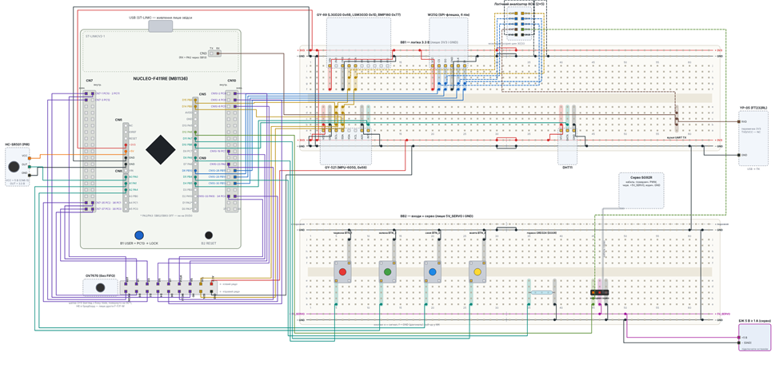

## 1. Зведена pinout-таблиця схеми підключення SmartLock

|Пін МК / Порт|Функція (AF)|Периферія / Сигнал|Роз'єм / Пін Nucleo|Модуль (Тип)|Пін пристрою|Напруга|Pull-up / Pull-down / Конфігурація|Примітка / Обґрунтування вибору|
|-|-|-|-|-|-|-|-|-|
|**PC0 – PC7**|Input|GPIO Input (D0–D7)|Morpho CN7|**OV7670** (Камера без FIFO)|D0–D7|3.3V|Вхід без підтяжки|Зчитування байта пікселя 1 зверненням `GPIOC->IDR \\\& 0xFF`|
|**PA8**|AF0|MCO1 (24 MHz)|Morpho CN9-D7|**OV7670** (Камера)|XCLK|3.3V|Немає|Тактування камери від HSE (PLLCLK / 4 = 24 МГц)|
|**PA10**|Input|GPIO Input|Morpho CN10|**OV7670** (Камера)|PCLK|3.3V|Немає|Синхронізація пікселів|
|**PC8**|EXTI8|EXTI Input|Morpho CN7|**OV7670** (Камера)|VSYNC|3.3V|Немає|Синхронізація кадрів (30.01 Гц)|
|**PC10/11/12**|Output/Input|GPIO|Morpho CN7|**OV7670** (Камера)|HREF/RST/PWDN|3.3V|Output / Input|Лінії керування та рядкової синхронізації|
|**PB8 / PB9**|AF4|I2C1\_SCL / I2C1\_SDA|CN5-D15 / D14|**GY-89** (LSM303D, L3GD20, BMP180), **OV7670** (SCCB), **GY-521**|SCL / SDA|3.3V|Зовнішні / CCR = 240 (100 кГц)|PB6 зайнятий DHT11, PB7 є лише на Morpho. GY-521 несправний (залишено під заміну)|
|**PB13/14/15**|AF5|SPI2\_SCK, MISO, MOSI|CN10-30/28/26|**W25Q64** (Flash-пам'ять, 6 виводів)|SCK, MISO, MOSI|3.3V|Mode 0, Prescaler 16 (3 МГц)|SPI1 конфліктує з LD2 (PA5), PWM (PA6) та кнопкою (PA7)|
|**PB10**|Output|GPIO (FLASH\_CS#)|CN9-D6|**W25Q64** (Flash-пам'ять)|CS#|3.3V|Програмний CS#|Апаратний NSS не гарантує утримання CS# протягом усієї команди|
|**PA6**|AF2|TIM3\_CH1 (PWM)|CN10-D12|**SG92R** (Сервопривід)|PWM (Signal)|3.3V(лог)|PSC = 95, ARR = 19999|Крок 1 мкс, період 20 мс (50 Гц). Живлення від окремої шини 5V\_SERVO|
|**PA0**|EXTI0|EXTI Input|CN8-A0|**HC-SR501** (PIR-сенсор)|OUT|3.3V|EXTI0|Сигнал руху (сенсор живиться від 5V, вихід 3.3V)|
|**PB5**|EXTI5|EXTI Input|Morpho CN10|**GY-521** (MPU-6050)|INT|3.3V|EXTI5|Переривання акселерометра|
|**PB4**|Input|GPIO Input|Morpho CN10|**ORD324** (Геркон)|Signal|3.3V|Pull-up|Датчик відкриття|
|**PB6**|Input|GPIO Input|Morpho CN10|**DHT11**|Data|3.3V|Pull-up|Датчик температури та вологості|
|**PA9/1/4/7**|Input|GPIO Input|Morpho CN9/8|**Кнопки** (4 шт)|Signal|3.3V|Pull-up|Кнопки керування|
|**PC13**|EXTI13|EXTI Input (USER B1)|Бортова кнопка B1|**LOCK** (Перемикач)|Button B1|3.3V|EXTI13|Перенесено з тумблера MS500EF через його несправність|
|**PA2 / PA3**|AF7|USART2\_TX / RX|CN3-RX / ST-LINK|**ST-LINK VCP / YP-05**|TX / RX|3.3V|115200 8N1|YP-05 знімає TX з CN3 «RX» (PA2/PA3 не виведені на D1/D0 через розімкнені SB62/SB63)|
|**PB0**|Input|GPIO Input|Morpho CN7|**Вільний**|-|-|-|Резервний пін|

---

## 2. Таблиця адрес і ідентифікаторів пристроїв

|Пристрій|Шина|I2C Адреса (7-bit) / Інтерфейс|Регістр ідентифікації|Очікуване значення (Hex)|Примітка / Стан|
|-|-|-|-|-|-|
|**GY-521 (MPU-6050)**|I2C1|`0x68` (AD0 = GND)|`WHO\\\_AM\\\_I` (0x75)|`0x68`|Несправний на стенді, залишено у схемі для заміни|
|**GY-89 (LSM303D)**|I2C1|`0x1D` (SDO/SA0)|`WHO\\\_AM\\\_I` (0x0F)|`0x49`|Акселерометр / Магнітометр|
|**GY-89 (L3GD20)**|I2C1|`0x6B`|`WHO\\\_AM\\\_I` (0x0F)|`0xD4`|Гіроскоп|
|**GY-89 (BMP180)**|I2C1|`0x77`|`ID` (0xD0)|`0x55`|Барометр|
|**OV7670**|I2C1 (SCCB)|`0x21`|`PID` (0x0A) / `VER` (0x0B)|`0x76` / `0x73`|Вимагає STOP між записом адреси й читанням|
|**W25Q64JV**|SPI2|SPI Mode 0|`JEDEC ID` (CMD: `0x9F`)|`EF 40 17`|Flash-пам'ять|

---

## 3. Бюджет живлення та струмове навантаження

Живлення розділено за трьома доменами з урахуванням робочих та пікових струмів:
- **Домен 5V_SERVO (окреме джерело):** Використовується для живлення сервоприводу SG92R. Пускові струми сервоприводу просаджують лінію 5V Nucleo, а також перевищують ліміт струму шини USB (300 мА). Обов'язковим є спільний GND.
- **Домен 3V3:** Живиться від стабілізатора плати Nucleo. Використовується для живлення всієї логіки (модулі GY-89, камера OV7670, Flash-пам'ять W25Q64).
- **Домен 5V_NUCLEO:** Використовується для живлення PIR-сенсора (його логічний вихід узгоджений до 3.3 В).

---

## 4. Параметри шин та дерево тактування

Джерело: **HSE 8 МГц** від ST-LINK (bypass), SYSCLK 96 МГц, APB1 48 МГц, APB2 96 МГц.

- **I2C1 (100 кГц):** Режим Standard Mode. Розраховане значення `CCR = 240` при частоті APB1 48 МГц. 
- **SPI2 (3 МГц):** Режим Mode 0. Дільник шини APB1 (48 МГц) налаштовано на 16. Читається JEDEC ID `EF 40 17`.
- **MCO1 (24 МГц):** Тактування камери. Обчислюється як PLL / 4 = 24 МГц.
- **TIM3_CH1 (50 Гц):** ШІМ для сервоприводу. Частота таймера 96 МГц. Налаштування: `PSC = 95`, `ARR = 19999` (96 МГц / 96 = крок 1 мкс, період 20 мс). Робочий імпульс: 1000 / 2000 мкс.

---

## 5. Схема підключення

Нижче наведено повну схему підключення стенда

---

## 6. Відхилені варіанти розкладки

Основні з них:

1. **SPI1 на D13–D11:** Конфлікт із бортовим світлодіодом LD2 (PA5), ШІМ-сигналом (PA6) та кнопкою (PA7).
2. **SPI3:** Його піни зайняті керуванням камери.
3. **Апаратний NSS для SPI:** Відхилено на користь програмного CS# на PB10, оскільки апаратний NSS не гарантує утримання низького рівня протягом усієї команди (наприклад, PP 256 Б, серія RDSR).
4. **UART на D0/D1:** Потребує перепаювання перемичок SB62/SB63.
5. **LOCK на тумблері:** Тумблер MS500EF виявився несправним (проблема №6). Функцію перенесено на бортову кнопку USER B1 (PC13).
6. **I2C1 на PB6/PB7:** Пін PB6 зайнятий датчиком DHT11, а PB7 є лише на роз'ємі Morpho (CN7-21).
7. **MCO1 від HSI:** Внутрішній генератор дає щонайбільше 16 МГц замість необхідних 24 МГц.
8. **Живлення серво від 5 В Nucleo:** Пускові струми сервоприводу просаджують напругу 5 В Nucleo, а також діє ліміт струму USB 300 мА.
