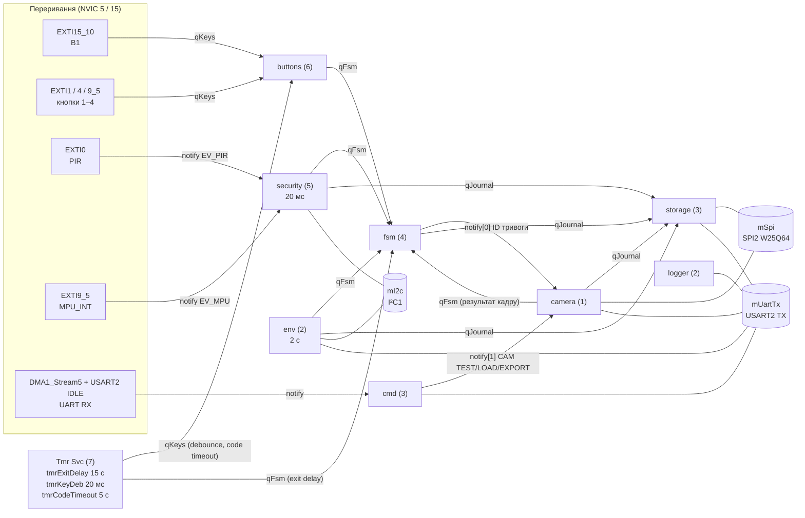

# Схема задач SmartLock на FreeRTOS (ЛР4, K01)

> Автор: Коваль М. Статус: **чернетка на погодження** (Колодницький — драйвери й UART, Собкович —
> метрики; затверджує Сюкало). Методичка ЛР4 §4–§5, §10. Основа для K03, K04, H02–H05 і розділу звіту
> «Схема задач».

Прошивка ЛР3, від якої відштовхується схема, — `main` після PR #67 (`fa33f85`), тег `lab3`.
Числа, яких немає в PRD, методичці чи вимірах ЛР3, позначено `TBD_` (правило `docs/tasks.md`): це
стартові значення, їх уточнюють виміри M01/M02 (стеки, heap) і прогони I06.

## 1. Принципи

1. **ISR лише фіксує подію і будить задачу** (методичка §5.2): мітка DWT (`ev_mark`, як у ЛР3) +
   один виклик `…FromISR` + `portYIELD_FROM_ISR`. Жодної логіки FSM, I²C, SPI чи `printf` в ISR.
2. **Пріоритет = жорсткість дедлайну** (deadline-monotonic, §5.1): входи людини й охорони —
   найвищі, довга зйомка — найнижча серед робочих. Мета — зняти обмеження 1–3 з `docs/limitations.md`.
3. **Дані між задачами — копією через черги**; спільна шина — під м'ютексом з тайм-аутом.
4. **Задачі з пріоритетом ≥ 4 не друкують у UART** — лише `Evt_Log` у RAM-кільце (як у ЛР3,
   `docs/superloop.md` §3). Тоді вони ніколи не чекають м'ютекса UART TX (≈ 5 мс на рядок).
   Перевірено за кодом: `sl_fsm.c`, `sl_security.c`, `sl_buttons.c` уже не викликають `printf`.
5. **Усе створюється статично до старту планувальника** (`xTaskCreateStatic`, `xQueueCreateStatic`,
   `xSemaphoreCreateMutexStatic`, `xTimerCreateStatic`): RAM видно в `.bss` і `make mem-report`, heap ОС
   не росте під час роботи (вимога §3 і властивість «пам'ять статична» з `limitations.md`).
6. **Команди, формати логів і `EVT`-імена ЛР3 не змінюються** (`docs/baseline-lab4.md` §5);
   банер — `loop=freertos`.

## 2. Таблиця задач

`configMAX_PRIORITIES = 8` (0…7). Розмір стека — у **словах** (×4 Б). Стартовий стек = (найглибший
ланцюжок задачі з `docs/metrics/memory.md` §2.2 + 256 Б на кадр контексту з FPU і виклики ядра) × 1,5,
округлено вгору до 32 слів. Обробники переривань працюють на окремому стеку MSP, тож їхні кадри до стеків
задач не додаються.

| Задача | Що робить (модуль ЛР3) | Пріоритет | Запуск: період або подія | Ланцюжок ЛР3 | Стек, слів |
|---|---|:-:|---|---:|---:|
| `Tmr Svc` | службова задача ядра: програмні таймери (§3.3) | **7** | команди таймерів | — | 256 (`configTIMER_TASK_STACK_DEPTH`) |
| `buttons` | B1 і 4 кнопки коду: антидребезг, збирання коду (`sl_buttons.c`) | **6** | подія: `qKeys` від EXTI і таймерів антидребезгу | 152 Б | 160 |
| `security` | PIR, геркон з антидребезгом, MPU-6050 → `MOTION` / `TAMPER` / `DOOR_*` (`sl_security.c`) | **5** | період `TBD_PERIOD_SECURITY_US` = 20 мс (`vTaskDelayUntil`) + сповіщення від EXTI PIR / MPU_INT | 288 Б | 224 |
| `fsm` | стани `UNLOCKED / EXIT_DELAY / LOCKED`, серво, запит кадру (`sl_fsm.c`, `sl_camera_link.c`) | **4** | подія: `qFsm` | 136 Б | 160 |
| `cmd` | рядкові команди ЛР3 і однолітерні ЛР2 (`cmd.c`, `bench.c`) | **3** | подія: сповіщення від DMA / IDLE UART; страхувальний тайм-аут `TBD_CMD_POLL_MS` = 10 мс | 1 072 Б | 512 |
| `storage` | журнал у W25Q64, рядки `EVT,id=…` (`sl_journal.c`, `storage.c`) | **3** | подія: `qJournal` | 624 Б | 352 |
| `env` | DHT11 + BMP180, `ENV,…`, `ENV_WARNING` (`sl_env.c`) | **2** | період `TBD_PERIOD_ENV_US` = 2 с (`vTaskDelayUntil`) | 640 Б | 352 |
| `logger` | друк кільця `EVT t_us=…`, `LOAD pct=`, перевірка піків `STACK`/`HEAP` (колишні `uart`-друк і `mem`) | **2** | сповіщення від `Evt_Log` або тайм-аут `TBD_LOGGER_PERIOD_MS` = 10 мс | 560 Б (`mem`) | 320 |
| `camera` | зйомка кадру, запис у W25Q64, `CAM TEST / LOAD / EXPORT` (`camera.c`, `cam_test.c`, `frame_export.c`) | **1** | подія: сповіщення від `fsm` (ID тривоги) або від `cmd` (команда `CAM`) | 664 Б | 352 |
| `IDLE` | простій, частка вільного CPU в run-time stats; WFI — не вмикаємо, доки йдуть виміри | 0 | автоматично | — | 128 (`configMINIMAL_STACK_SIZE`) |

Разом стеки: 2 816 слів = **11 264 Б** (оцінка). Гіпотеза 6 з `limitations.md` — 6–10 КБ. Стартовий
запас свідомо більший: після S3 стеки зменшуються за `uxTaskGetStackHighWaterMark` (M02), у звіті
наводяться обидва числа — «зарезервовано» і «використано».

Що прибирається з робочої збірки: кооперативний планувальник `sched.c` (K03). Задача `mem` ЛР3
переходить у `logger` (той самий рядок `STACK`/`HEAP`, плюс рядок на кожну задачу — `baseline-lab4.md` §5).
Задача `uart` ділиться на `cmd` (прийом і розбір) і `logger` (фоновий друк).

### 2.1. Обґрунтування пріоритетів

| Пріоритет | Задача | Вимога PRD / обмеження ЛР3 | Чому саме тут |
|:-:|---|---|---|
| 7 | `Tmr Svc` | FR-03 (15,0 ± 0,1 с), FR-09 (антидребезг) | таймери відміряють 15 с і антидребезг; колбеки лише кладуть подію в чергу (мікросекунди), тому найвищий пріоритет не забирає CPU, але гарантує, що тайм-аут не чекатиме зйомки |
| 6 | `buttons` | FR-09, FR-10 (5/5 кодів), FR-02 (B1); обмеження 1, 2; issue #54 | натискання людини губляться саме тоді, коли їх не встигають забрати (ЛР3: `WRONG_CODE` 2/5); робота — мікросекунди без шин, тож вона нікого не затримує; гіпотеза: реакція B1 max 2 137 мс → ≤ 20 мс |
| 5 | `security` | FR-05, FR-06 (`TAMPER` 3/3), FR-13; обмеження 1, 3, 7; issue #57 | жорсткий період 20 мс (джитер у ЛР3 до 2,9 с); читання MPU 1,56 мс по I²C — тому нижче `buttons`, щоб шина не затримувала натискання |
| 4 | `fsm` | FR-01, FR-03, FR-04, FR-11, FR-13 | споживач подій від задач 5–7: виконується одразу після того, як вони заблокувались, і обробляє чергу пачкою; сама робота коротка (без `printf` і шин); вище за `cmd` і `storage`, щоб LOCK/UNLOCK не чекав друку чи Flash |
| 3 | `cmd` | FR-12; обмеження 5 | розбирає команди під час зйомки — гіпотеза `rx_overrun` 1 → 0 при 100 Гц |
| 3 | `storage` | FR-08, FR-10, FR-13 (записи в W25Q64) | записи можна відкласти на десятки мс, але не на 2 с зйомки; рівний з `cmd` пріоритет — квантування часу між ними (`configUSE_TIME_SLICING 1`) |
| 2 | `env` | FR-14, FR-15 | період 2 с, допуск — секунди; DHT11 ≈ 25 мс і BMP180 ≈ 12 мс блокують, тож задача має поступатися всім, крім камери |
| 2 | `logger` | FR-12, вимірювання (`EVT`, `LOAD`, `STACK`) | друк не має спотворювати виміряні інтервали (як у ЛР3), але має йти й під час зйомки, інакше `EVTLOG dropped` (у S3 ЛР3 — 1 005) |
| 1 | `camera` | FR-07; обмеження 1 | зйомка 1,3–2,1 с + запис 0,85 с — найдовша операція; найнижчий пріоритет, щоб її витісняли всі (між лініями кадру, коли переривання ввімкнені) |

## 3. Механізми взаємодії

### 3.1. Черги і сповіщення

| Механізм | Від → до | Елемент | Глибина | Поведінка при заповненні |
|---|---|---|---:|---|
| `qKeys` (черга) | EXTI B1 і кнопок 1–4, колбек таймера антидребезгу → `buttons` | `key_ev_t` {`src` (B1, K1…K4), `kind` (фронт / стабільно), `t_cyc` DWT} — 8 Б | `TBD_KEYQ_LEN` = 32 | `xQueueSendFromISR` без очікування; невдача → лічильник `key_lost` (той самий, що `Platform_KeyLost()`) |
| `qFsm` (черга) | `buttons`, `security`, `env`, таймер `tmrExitDelay`, `camera` (результат кадру) → `fsm` | `sl_event_t` {`type`, `arg`, `t_cycles`} — 12 Б (`event_queue.h`) | `TBD_EVQ_LEN` = 8 | `xQueueSend(…, 0)`; невдача → `EVQ dropped` (рядок `STATS` без змін) |
| `qJournal` (черга) | `fsm`, `security`, `env`, `camera` → `storage` | `sl_log_rec_t` — 20 Б (`sl_journal.h`) | `TBD_JOURNAL_FIFO_LEN` = 16 | ID запису (`seq`) видає `SmartLock_LogEvent` у критичній секції — він потрібен одразу (зв'язок кадр ↔ тривога); сам запис — копією в чергу; невдача → `JournalDropped` |
| сповіщення `security`, біти | EXTI0 (PIR), EXTI9_5 (MPU_INT) → `security` | `EV_PIR`, `EV_MPU` (`eSetBits`) | — | біт уже стоїть → лічильник `OVR name=pir|mpu` (як `ev_overruns` у ЛР3) |
| сповіщення `camera`, індекс 0 | `fsm` → `camera` | ID тривоги (`eSetValueWithoutOverwrite`) | 1 | зайнято → відмова, як `SmartLock_CameraRequest()` у ЛР3 (`rejected++`) |
| сповіщення `camera`, індекс 1 | `cmd` → `camera` | біти `CAM_TEST`, `CAM_LOAD`, `CAM_EXPORT` | — | `configTASK_NOTIFICATION_ARRAY_ENTRIES = 2` |
| сповіщення `cmd` | DMA1 Stream5 (HT/TC), USART2 IDLE → `cmd` | лічильник (`vTaskNotifyGiveFromISR`) | — | байти лишаються в DMA-кільці 2 048 Б; переповнення → `PLATFORM_UART_LOST`, як у ЛР3 |
| сповіщення `logger` | `Evt_Log` у задачах → `logger` | лічильник | — | кільце `EVT_RING_LEN` = 64; переповнення → `EVTLOG dropped` |

**Результат кадру.** У ЛР3 `camera.c` викликає `SmartLock_OnCameraResult()` напряму. У ЛР4 таблицю
зв'язків `sl_camera_link.c` змінює лише `fsm`: `camera` кладе результат у `qFsm` (новий тип події),
щоб у таблиці був один власник і не знадобився ще один м'ютекс. Деталі — K04.

**Event groups** не використовуються: немає вимоги «чекати комбінацію подій»; порядок старту задає
те, що всі об'єкти й задачі створюються до `vTaskStartScheduler()` (§5).

### 3.2. Взаємне виключення

| Ресурс | Хто користується | Механізм | Тайм-аут | Найдовше утримання (ЛР3) | Ризик |
|---|---|---|---|---|---|
| I²C1 (MPU-6050, BMP180, LSM303D) | `security` (5), `env` (2), `cmd` (стендові команди) | м'ютекс `mI2c` | `TBD_I2C_MUTEX_MS` = 30 | BMP180 12,0–12,7 мс; зависла шина ≈ 26 мс на звернення (лог 15) | інверсія `env` → `security`: пом'якшує успадкування пріоритету; щоб утримання було коротшим, BMP180 відпускає м'ютекс на час перетворення (H02) |
| SPI2 (W25Q64: журнал і кадри) | `storage` (3), `camera` (1), `cmd` (`CAM LOAD`, дамп журналу) | м'ютекс `mSpi` | `TBD_SPI_MUTEX_MS` = 100 | стирання сектора 63,4–64,0 мс (datasheet — до 400 мс); запис кадру 0,85 с | `camera` бере м'ютекс **на сторінку** (≈ 2 мс) або сектор, а не на весь кадр, — інакше журнал чекав би 0,85 с; очікування готовності Flash — `vTaskDelay(1)`, а не активне опитування (H02) |
| USART2 TX (`printf`) | `cmd`, `storage`, `env`, `logger`, `camera` | м'ютекс `mUartTx` на рядок | `portMAX_DELAY` (утримувачі — лише задачі ≤ 3) | ≈ 86,8 мкс × символ, рядок ≈ 5 мс; `STATS` ≈ 0,12 с | `FATAL …` з хуків друкує без м'ютекса (система вже зупинена) |
| кільце `EVT` (`evt.c`) | усі задачі | `taskENTER_CRITICAL` на запис (мікросекунди) | — | — | — |
| лічильник `seq` журналу, статистика `perf` | кілька задач, читає `cmd` (`STATS`) | `taskENTER_CRITICAL` | — | — | — |

Камера налаштовується по SCCB (окремі GPIO), яким користується лише `camera`, — м'ютекс не потрібен.
DHT11 — окремий GPIO, теж без м'ютекса.

### 3.3. Програмні таймери

| Таймер | Тип | Тривалість | Колбек | Вимога |
|---|---|---|---|---|
| `tmrExitDelay` | одноразовий | 15 000 мс (`pdMS_TO_TICKS`) | подія «відлік завершено» в `qFsm` | FR-03, FR-13 |
| `tmrKeyDeb[5]` (B1, K1…K4) | одноразовий, перезапуск на кожен фронт | `TBD_BTN_DEBOUNCE_MS` = 20 мс | `{src, стабільно}` у `qKeys` | FR-02, FR-09; K06 (issue #54) |
| `tmrCodeTimeout` | одноразовий | `TBD_CODE_TIMEOUT_MS` = 5 000 мс | «тайм-аут коду» в `qKeys` | FR-09 |

`configTIMER_QUEUE_LENGTH = TBD 10`. Антидребезг геркона (`TBD_DOOR_DEBOUNCE_MS` = 100) і об'єднання
серії PIR (`TBD_PIR_MIN_INTERVAL_MS`) лишаються на періоді `security` (20 мс): ця логіка вже працює
за часом і не потребує окремих таймерів.

Роздільна здатність усіх тайм-аутів — 1 тік (1 мс). FR-03 вимагає ± 100 мс, гіпотеза ЛР3 — ± 2 мс.

## 4. Переривання

`NVIC_PRIORITYGROUP_4`, `configMAX_SYSCALL_INTERRUPT_PRIORITY = 5`: усі переривання, що викликають
API ядра, мають пріоритет **числом ≥ 5** (методичка §4.10). Зараз EXTI мають пріоритет 0
(`Core/Src/gpio.c:164–170`, `Platform/platform_io.c:118–120`) — K02 виставляє 5.

| Переривання | Джерело (пін) | NVIC | Що робить ISR | Кого будить і чим |
|---|---|:-:|---|---|
| EXTI0 | PIR (PA0), фронт | 5 | мітка DWT (`ev_mark`) | `security`: `xTaskNotifyFromISR(EV_PIR, eSetBits)` |
| EXTI1 | кнопка 2 (PA1) | 5 | — | `buttons`: `xQueueSendFromISR(qKeys)` |
| EXTI4 | кнопка 3 (PA4) | 5 | — | `buttons`: `xQueueSendFromISR(qKeys)` |
| EXTI9_5 | MPU_INT (PB5) | 5 | мітка DWT | `security`: `xTaskNotifyFromISR(EV_MPU, eSetBits)` |
| EXTI9_5 | кнопки 4 (PA7) і 1 (PA9) | 5 | — | `buttons`: `xQueueSendFromISR(qKeys)` |
| EXTI9_5 | VSYNC камери (EXTI8) | 5 | лише `vsync_count++` | нікого (API ядра не викликає) |
| EXTI15_10 | B1 (PC13), спад | 5 | мітка DWT | `buttons`: `xQueueSendFromISR(qKeys)` |
| DMA1_Stream5 | USART2_RX, HT / TC | 15 (як у ЛР3, `UART_RX_DMA_IRQ_PRIO`) | — | `cmd`: `vTaskNotifyGiveFromISR` |
| USART2 (нове) | IDLE лінії | 15 | зняти прапорець IDLE | `cmd`: `vTaskNotifyGiveFromISR` (короткі команди не чекають HT при 1 024 Б) |
| SysTick | ядро | 15 (`configKERNEL_INTERRUPT_PRIORITY`) | тік ОС | розблоковує задачі за часом |
| PendSV, SVCall | ядро | 15 | перемикання контексту / старт | — |
| TIM11 (нове) | timebase HAL | `TBD 4` | `HAL_IncTick()` | нікого: API ядра не викликає, тож може бути вище за межу 5 і не маскується критичними секціями ядра |

Після кожного `…FromISR` — `portYIELD_FROM_ISR(woken)`: якщо розбуджена задача вища за поточну,
вона отримує процесор одразу після виходу з переривання.

**MPU_INT.** У ЛР3 переривання в самому MPU-6050 не ввімкнене (на PB5 завжди 0), `TAMPER` виявляється
опитуванням `security` раз на 20 мс. Схема лишає для нього місце; чи вмикати переривання датчика —
у межах issue #57 (H04, Колодницький).

### 4.1. Ділянки з вимкненими перериваннями

Це не змінює ОС (обмеження 4 у `limitations.md`), але тепер впливає й на тік ОС:

| Де | Тривалість | Наслідок для ОС | Хто вирішує |
|---|---|---|---|
| `Platform_Dht11Capture()`, `__disable_irq` | ≈ 4–5 мс раз на 2 с | до 4 тіків загублено (у `SysTick` лише один відкладений запит) | H02 |
| `camera_dvp.c:172–174`, маскування на лінію кадру (`irq_lock_per_line`) | ≈ 1,7 мс на лінію (з картки K04, ще не виміряно), 120 ліній | до 1 тіка на лінію, тобто орієнтовно до ~120 мс відставання часу ОС за кадр | K04 |

Перевірка: різниця `xTaskGetTickCount()` і DWT до і після зйомки (лічильник тіків, картка K04). Якщо
відставання є, K04 скорочує вікно маскування або обґрунтовує його тут. FR-03 це зачіпає, лише якщо
зйомка припаде на `EXIT_DELAY`: за PRD кадр знімається в `LOCKED`.

## 5. Старт

1. `main()` → HAL, тактування 96 МГц, timebase HAL на TIM11 (K02), `MX_*_Init`.
2. `App_Init()` як у ЛР3: банер `BUILD,…,loop=freertos`, `Platform_BringUp()`, ініціалізація датчиків,
   self-test (≈ 1,3 с, з `HAL_Delay` — ще до планувальника, тож TIM11 уже працює).
3. `AppRtos_Start()`: статичні черги, м'ютекси, таймери, задачі з таблиці §2 → `vTaskStartScheduler()`.
4. Після старту ядра `HAL_Delay` у задачах не використовується (замінюється на `vTaskDelay`, H02).

## 6. Діаграма взаємодії

## 7. Як перевірити задум (методичка §5.4 → сценарії I06)

| Питання | Метрика | Сценарій | Очікування (гіпотези ЛР3) |
|---|---|---|---|
| натискання не губляться під час зйомки | FR-10 `WRONG_CODE` / `ACCESS_GRANTED`; 20 натискань під час зйомок поспіль | FR-10, K06 | 5/5 і 5/5; 0 втрачених із 20 |
| удар фіксується під час зйомки | E2E-02 `TAMPER` | E2E-02, H04 | 3/3 |
| реакція B1 не залежить від зйомки | `btn_b1_lat` max, аналізатор PC13 → PB1 | S3 | ≤ 20 мс |
| `security` тримає період під час зйомки | `JITTER name=security` max, `missed` | S3 | ≤ 20 мс, пропуски ≈ 0 |
| `env` з `mI2c` не ламає період `security` | `JITTER name=security` у вікні читання BMP180 | S3 | ≤ 13 мс додатково (утримання м'ютекса) |
| `cmd` встигає під потоком | `UART rx_overrun` / `rx_peak` | §6.2, 100 Гц під час `CAM TEST` | 0 / < 1 100 Б |
| запас стеків | `STACK task=… free_min_words=…` | після S3 | ≥ `TBD_STACK_MARGIN` (наприклад 25 %) у кожній задачі |
| відлік 15 с | FR-03 | S2 | 15,000 ± 0,002 с |

## 8. Відкриті рішення

| № | Питання | Пропозиція | Хто погоджує |
|---|---|---|---|
| 1 | Прийом UART: stream buffer (як у картці K01 і прикладі методички) чи DMA-кільце ЛР3 + сповіщення | DMA-кільце + сповіщення: байти не копіюються вдруге, а `rx_overrun` / `rx_peak` лишаються тими самими метриками, що в базовій лінії ЛР3 (`baseline-lab4.md` §5). Stream buffer — лише якщо команда наполягає на ньому для звіту | Колодницький (H03), Сюкало |
| 2 | `JITTER name=buttons`: `buttons` стає подієвою, періоду 10 мс більше немає | натомість — затримка «фронт → обробка» (`btn_b1_lat`, нові `key_lat`); у порівняльній таблиці рядок «пропуски `buttons`» замінити на «втрачені натискання» з поясненням | Собкович (M01) |
| 3 | Розміри стеків, глибини черг, тайм-аути м'ютексів (`TBD_` у §2–3) | стартові значення з цього документа; остаточні — за виміром після S3 | Собкович (M02), Коваль |
| 4 | Маскування переривань на лінію кадру (§4.1) | виміряти відставання тіків; скоротити вікно або обґрунтувати | Коваль (K04), Непорожній (I04) |
| 5 | Пріоритет TIM11 (timebase HAL) | 4: вище за межу ядра, бо API ядра не викликає | Коваль (K02) |
| 6 | Розширення DWT до 64 біт (`Perf_TimeUs64`, переповнення кожні 44,7 с при 96 МГц) | оновлювати в `logger` (тайм-аут 10 мс) і в хуку тіку; той самий лічильник — для run-time stats | Собкович (M01) |
| 7 | Версія FreeRTOS-Kernel | записати тег сюди після K02 | Коваль (K02) |

## 9. Конфігурація ядра (заповнює K02)

| Параметр | Значення | Чому |
|---|---|---|
| версія FreeRTOS-Kernel, порт | `TBD` (K02), `portable/GCC/ARM_CM4F` | вимога §3 методички |
| heap | `heap_4.c`, `configTOTAL_HEAP_SIZE = TBD` | об'єкти статичні (§1, п. 5); heap лише як резерв |
| `configTICK_RATE_HZ` | 1000 | роздільна здатність 1 мс, як `HAL_GetTick` у ЛР3 |
| `configMAX_PRIORITIES` | 8 | §2 |
| `configUSE_PREEMPTION` / `configUSE_TIME_SLICING` | 1 / 1 | §2.1 (`cmd` = `storage`, `env` = `logger`) |
| `configSUPPORT_STATIC_ALLOCATION` | 1 | §1, п. 5 |
| `configTASK_NOTIFICATION_ARRAY_ENTRIES` | 2 | §3.1 (`camera`) |
| `configUSE_TIMERS`, `configTIMER_TASK_PRIORITY`, `configTIMER_TASK_STACK_DEPTH` | 1, 7, 256 | §3.3 |
| `configMAX_SYSCALL_INTERRUPT_PRIORITY` | 5 | §4 |
| run-time stats, stack overflow, хуки | за карткою K02 і методичкою §4.11, §6.2 | M01 |
